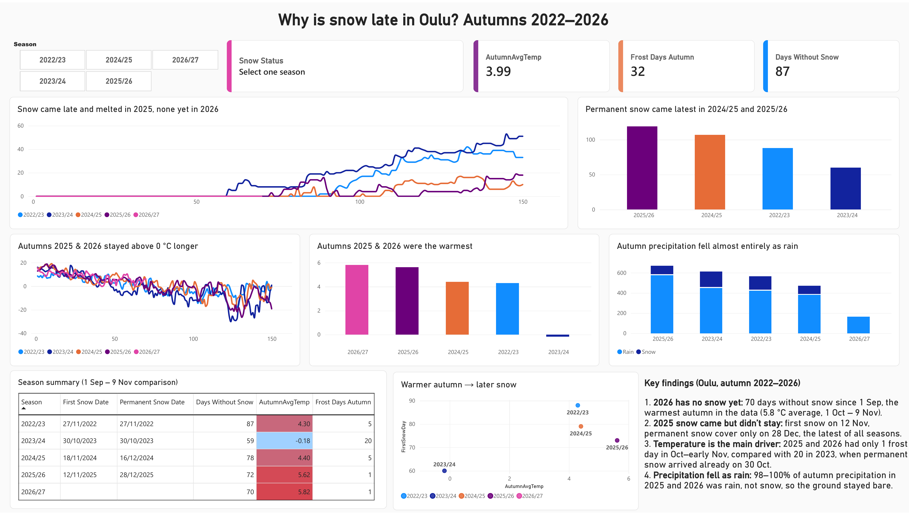
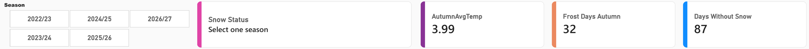
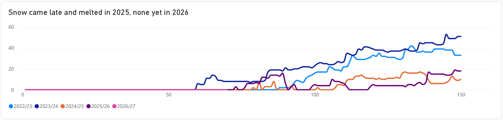
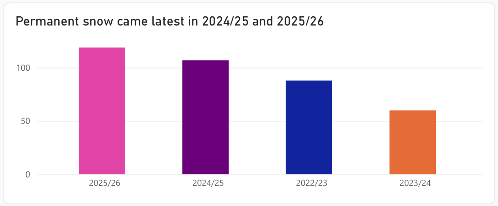
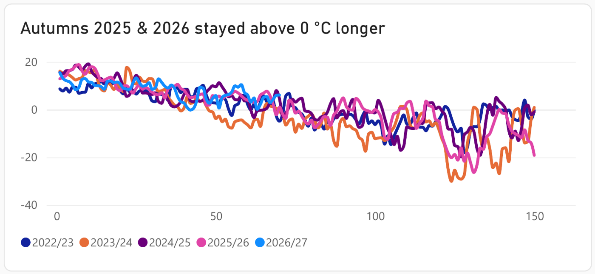
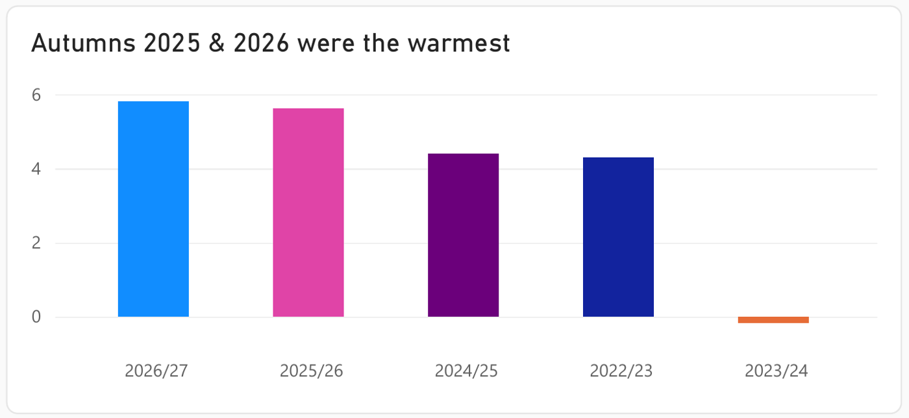
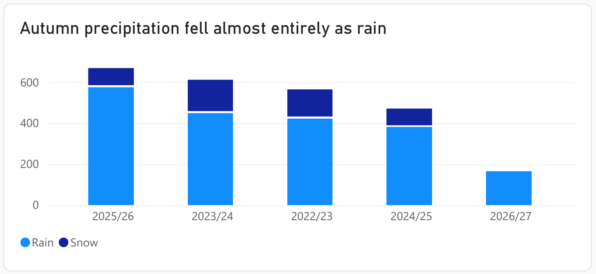
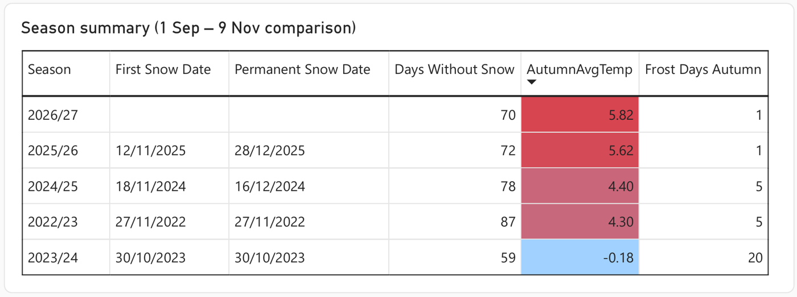
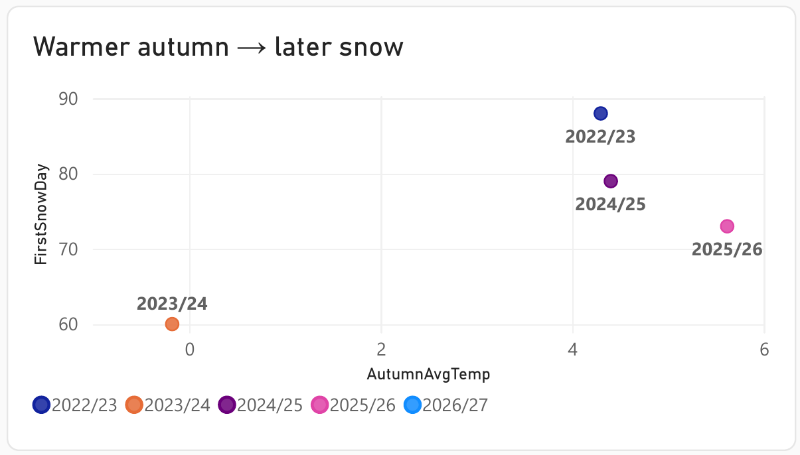

# Oulu Snow Delay Analysis
### Why is snow late in Oulu? Autumns 2022–2026

Living in Oulu, I noticed that last winter the snow came really late, and this year (November 2026) there is still no snow at all. I wanted to check if this is just a feeling or if the data actually shows it, and more importantly, why it happened.

So I took daily weather data from the Finnish Meteorological Institute for the last four years plus the current autumn, cleaned it, and built a Power BI dashboard to compare the seasons.

**Live report in Power BI Service:** [Open the dashboard](https://app.powerbi.com/groups/me/reports/d414927a-9162-44ec-95b5-9af856a4c9a6/8f997439de13cd825b02?experience=power-bi)

## The question

Why did the snow come late in Oulu in 2025, and why has it not come at all yet in 2026?

## Short answer

Because these were the two warmest autumns in the data. It was simply too warm: precipitation came as rain instead of snow, and the ground almost never froze, so the little snow that fell in 2025 melted again and the snow cover stayed only from late December.

## What I found

| Season | First snow | Permanent snow cover | Avg temp 1 Oct – 9 Nov | Frost days 1 Oct – 9 Nov |
|---|---|---|---|---|
| 2022/23 | 27 Nov 2022 | 27 Nov 2022 | 4.3 °C | 5 |
| 2023/24 | 30 Oct 2023 | 30 Oct 2023 | −0.2 °C | 20 |
| 2024/25 | 18 Nov 2024 | 16 Dec 2024 | 4.4 °C | 5 |
| 2025/26 | 12 Nov 2025 | 28 Dec 2025 | 5.6 °C | 1 |
| 2026/27 | no snow yet | – | 5.8 °C | 1 |

*(Data up to 9 Nov 2026.)*

1. **2026 has no snow yet.** 70 days since 1 September without snow, and it is the warmest autumn in the data.
2. **In 2025 the snow came but did not stay.** First snow on 12 November, but permanent snow cover only on 28 December, the latest of all seasons.
3. **Temperature is the main driver.** 2025 and 2026 had only 1 frost day between 1 October and 9 November. In 2023, the only cold autumn, there were 20 frost days and the snow stayed from 30 October.
4. **It wasn't dry, it was rain.** 98–100% of the autumn precipitation in 2025 and 2026 fell as rain.

The scatter chart shows the pattern quite clearly: the colder the autumn, the earlier the snow.

## Data

All data is open data from the [Finnish Meteorological Institute (FMI)](https://en.ilmatieteenlaitos.fi/download-observations), daily observations, 1 Sep 2022 – 9 Nov 2026.

No single station had everything I needed, so I combined three:

| Station | Used for | Why |
|---|---|---|
| Oulu airport | Temperature (mean, min, max) | Complete, no missing days, but no snow data |
| Oulu Oulunsalo Pellonpää | Snow depth and precipitation until 31 Aug 2024 | Data ends on 3 Dec 2024 |
| Oulu Kaukovainio | Snow depth and precipitation from 1 Sep 2024 | Data starts on 9 Nov 2023 |
| Oulu Vihreäsaari harbour | Not used | No snow data, temperature affected by the sea |

Pellonpää and Kaukovainio overlap for about a year and their snow depths follow each other closely (correlation 0.95), but Kaukovainio reports around 6 cm less snow on average. Because of that I compare the seasons by **dates** (when snow came and stayed), not by exact snow depth.

## Data cleaning

Done in Power Query. The main steps:

- `-` in the FMI files means a missing value → changed to null
- `-1` in snow depth means no snow, and `-1` in precipitation means no precipitation → changed to 0
- Created a `Date` column from Year, Month and Day
- Joined the temperature data (airport) with the snow and precipitation data (Pellonpää + Kaukovainio) on date
- Added helper columns:
  - `Season` – a winter crosses two calendar years, so a season runs from 1 Sep to 31 Aug (e.g. `2025/26`)
  - `DayOfSeason` – day 1 = 1 September, so all seasons can be drawn on the same axis
  - `HasSnow` – 1 if snow depth is at least 1 cm
  - `IsFrostDay` – 1 if the daily mean temperature is below 0 °C
  - `PrecipType` – Rain, Snow or None, based on precipitation and temperature

The cleaned table is in `data/clean/Weather.csv` (1,531 rows, one per day).

## Dashboard

The page is built to be read from top to bottom:

- **Top row:** season slicer and cards (snow status, autumn temperature, frost days, days without snow)
- **What happened:** snow depth per season and when permanent snow arrived
- **Why it happened:** daily temperature, autumn average temperature, and rain vs. snow
- **Conclusion:** season summary table, temperature vs. snow scatter, and key findings

To compare seasons fairly, temperature and frost days are always measured over the same window, 1 Oct – 9 Nov, because the current season only has data up to 9 November.

All DAX measures are in `dax/measures.dax`.

### 1. Season slicer and cards

The top row is the only part that reacts to the season slicer. When you pick a season, the cards show:

- **Snow Status** – when the first snow came, or "No snow yet" with the number of days so far
- **AutumnAvgTemp** – average temperature from 1 Oct to 9 Nov
- **Frost Days Autumn** – days with a mean temperature below 0 °C in the same window
- **Days Without Snow** – days from 1 September until the first snow

For example, 2026/27 shows *No snow yet – 70 days without snow*, 5.8 °C and 1 frost day. 2023/24 shows −0.2 °C and 20 frost days. When no season is selected, the cards show totals for all seasons, so it's best to click one.

The charts below are not filtered by the slicer on purpose, so they always compare all seasons.

### 2. Snow depth by season

Daily snow depth (cm) for each season, from 1 September to the end of January.

- **2023/24** (dark blue) gets snow first, around day 60 (end of October), and it keeps building up.
- **2025/26** (purple) gets a little snow in mid-November, but it goes back to zero and only starts to stay at the end of December.
- **2026/27** (pink) is a flat line at zero: no snow at all so far.

This is the visual that shows the problem most clearly.

### 3. When permanent snow arrived

The day of the season when snow cover started and then stayed for at least 30 days in a row. A taller bar means a later start.

- 2025/26: day 119 (28 December), the latest
- 2024/25: day 107 (16 December)
- 2022/23: day 88 (27 November)
- 2023/24: day 60 (30 October), the earliest

2026/27 has no bar because there is no snow yet. I added this chart because the first snow date alone can be misleading. In 2025 the first snow came on 12 November, which doesn't look late, but it melted away. The permanent snow date shows the real delay.

### 4. Daily temperature

Daily mean temperature for each season. The interesting part is around day 30–90 (October to November): this is where the temperature normally drops below 0 °C. In 2023/24 it goes below zero already in October, while 2025/26 and 2026/27 stay above zero much longer.

### 5. Average autumn temperature

Average temperature from 1 October to 9 November for each season, sorted from warmest to coldest.

- 2026/27: 5.8 °C
- 2025/26: 5.6 °C
- 2024/25: 4.4 °C
- 2022/23: 4.3 °C
- 2023/24: −0.2 °C

The two seasons with late snow are the two warmest autumns. The difference between 2023 and 2026 is 6 degrees.

### 6. Rain vs. snow

Total precipitation (mm) per season, split into rain (light blue) and snow (dark blue). Rain or snow is decided from the daily mean temperature: above 0 °C counts as rain.

Most precipitation in every season falls as rain, because the season includes autumn. But in the 1 Oct – 9 Nov window, 98–100% of the precipitation in 2025 and 2026 was rain. 2026/27 has a small bar only because the season has just started (data up to 9 November).

### 7. Season summary table

All key numbers in one place: first snow date, permanent snow date, days without snow, average autumn temperature and frost days. The temperature column is coloured: red is warm, blue is cold. The only blue season (2023/24) is also the one with the earliest snow.

### 8. Warmer autumn → later snow

Each dot is one season. The x-axis is the average autumn temperature and the y-axis is the day of the first snow.

2023/24 is alone in the bottom-left corner (cold autumn, early snow), while all the warmer autumns are on the right with clearly later snow. Among the warm autumns the order isn't perfect: 2022/23 got its first snow later than 2025/26, but in 2025 that first snow melted again (see chart 3). 2026/27 is not shown because there is no first snow day yet. With only five seasons this is a pattern, not a proof, but it points in the same direction as the other charts.

## Limitations

- Five seasons are enough to compare years, but not enough to prove a long-term climate trend.
- The snow data comes from two different stations, which is why I compare dates and not snow depths.
- Rain vs. snow is estimated from the daily mean temperature, which is a simplification.
- I didn't test other possible causes such as the Baltic Sea water temperature or the North Atlantic Oscillation (NAO). That would be the next step.
- The dashboard explains why the snow was late. It does not forecast when it will come.

## Next steps

- Download 30 years of data (1995–2026) to get a proper "normal" snow date
- Add sea water temperature and the NAO index as possible explanations
- Try a simple model that estimates the snow date from autumn temperature

## Tools

Power BI Desktop, Power Query, DAX, FMI open data.
